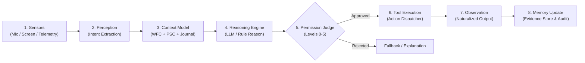

# Project ATMAN: Antigravity Master System Handoff

**Instance**: JARVIS / EXO (Personal Cognitive Agent OS)  
**Operator**: Michael ("Mike")  
**Public Repository**: [https://github.com/atmanlabs/ATMaN](https://github.com/atmanlabs/ATMaN)  
**Workstation**: `DESKTOP-2O9GQPK` (Windows 11)  
**Relay Gateway**: `http://127.0.0.1:<relay-port>` (Local) / Private Authenticated Mesh  
**Timestamp**: Wednesday, September 23, 2026, 07:28 EDT  
**Version**: 2.4.0 (Post-Conversational Guard & Continuous Person-Context Synchronization)  

---

## 1. Executive Summary & Current Operational State

This handoff provides any incoming Antigravity agent or developer with complete, authoritative context regarding Project ATMAN's live implementation on Michael's workstation. 

### Recent Critical Updates (September 22–23, 2026)
1. **Conversational Guard & Search Suppression Synchronization**:
   - Resolved the critical intent-hijacking bug where standard conversational queries (`what is`, `what are`, `how to`) were incorrectly classified as autonomous web searches.
   - Enforced negative directive detection (e.g., *"Do not look anything up"* suppresses tool calls).
   - Fixed query echoing in `_formulate_search_query` which was sending entire conversational utterances to web search.
   - Fixed the scout auto-apply flaw in [`self_improve/engine.py`](file:///C:/Users/Operator/Documents/exo-live/self_improve/engine.py): raw external research proposals are now safely parked for supervision rather than auto-applied.
   - Synchronized and verified across all three repository copies on the machine.
2. **Continuous Personhood & Dynamic Context**:
   - Integrated [`personhood.py`](file:///C:/Users/Operator/Documents/exo-live/personhood.py) and [`person_context.py`](file:///C:/Users/Operator/Documents/exo-live/person_context.py) with an append-only journal ([`PERSON_JOURNAL.jsonl`](file:///C:/Users/Operator/Documents/exo-live/self_improve/PERSON_JOURNAL.jsonl)).
   - Enforced ground-truth temporal grounding (`Wednesday, September 23, 2026`).
   - Grounded improvement inquiries in verified journal entries rather than hallucinated operating system patches.
3. **Current Live State (Morning of September 23, 2026)**:
   - **76 active skills** registered in [`skills.json`](file:///C:/Users/Operator/Documents/exo-live/skills.json).
   - Rolling evolve engine active through tick 126.
   - All unit and integration test suites passing.

---

## 2. Machine Environment & Repository Topology

| Role | Absolute Path | Description & Notes |
| :--- | :--- | :--- |
| **Live Mind (Runtime)** | [`C:/Users/Operator/Documents/exo-live`](file:///C:/Users/Operator/Documents/exo-live) | Active production instance executed via [`EXO.bat`](file:///C:/Users/Operator/Desktop/EXO.bat) or `loop.py`. |
| **Build & Staging** | [`C:/Users/Operator/Desktop/ATMAN/jarvis-build/exo-live`](file:///C:/Users/Operator/Desktop/ATMAN/jarvis-build/exo-live) | Local staging repository for build validation and sync testing. |
| **Public Scaffold** | [`C:/Users/Operator/Desktop/jarvis-scaffold-public`](file:///C:/Users/Operator/Desktop/jarvis-scaffold-public) | Scrubbed distribution bundle ready for public GitHub push (no private secrets). |
| **Private Core (Sealed)** | [`C:/Users/Operator/Documents/exo-private`](file:///C:/Users/Operator/Documents/exo-private) | Contains [`tsc.exo.private.json`](file:///C:/Users/Operator/Documents/exo-private). **Never commit or display.** |
| **Relay Service** | `http://127.0.0.1:<relay-port>` | Conversational HTTP/WebSocket relay server ([`relay.py`](file:///C:/Users/Operator/Documents/exo-live/relay.py)). |
| **Worker Gateway** | `http://127.0.0.1:18789` | OpenClaw worker tool service. |
| **Local LLM Engine** | `http://127.0.0.1:11434` | Ollama runtime serving `qwen2.5:3b` and `qwen2.5:7b`. |

---

## 3. Core Architectural Directives



### Directive 1: The Model is NOT the Self
The underlying language model is an interchangeable component used for natural language parsing, hypothesis generation, and tool proposal. The self resides in the surrounding harness:
- The immutable identity store (TSC)
- The evidence-based memory (PSC)
- The capability-gated permission system (Judge)
- Continuous audit logs and execution history

### Directive 2: Four-Layer Selfhood Model
1. **Layer A — Immutable Identity (`ImmutableIdentity`)**: Fundamental principles (P1–P5), recognized authority model (`operator_first_hierarchical_judge`). Sealed by cryptographic digest. Runtime modifications raise violations.
2. **Layer B — Stable Character (`StableCharacter`)**: Communication style, temperament, long-term goals. Modifiable **only** by deliberate, verified operator review (`deliberate_operator_review_confirmed=True`).
3. **Layer C — Learned Preferences (`LearnedPreferences`)**: Tool favorites, coding conventions, output verbosity. Updated monotonically based on interaction evidence.
4. **Layer D — Temporary State (`TemporaryState`)**: Volatile scratchpad per conversation turn (mood estimate, active telemetry, active window). Discardable.

### Directive 3: Six-Tier Capability Permission System
Every proposed action passes through [`permission_judge.py`](file:///C:/Users/Operator/Documents/exo-live/permission_judge.py):
- **Level 0 (Observe)**: Telemetry read, clock inspect, sandboxed memory search.
- **Level 1 (Suggest)**: Drafted text responses, speculative diffs, recommendations (zero side-effects).
- **Level 2 (Act Low)**: Calculator, ephemeral local documentation reads.
- **Level 3 (Act Medium)**: Sandbox unit test runs, reminder creation, evidence preference imprinting.
- **Level 4 (Act High / Sensitive)**: Modifying non-scratch files, package installation, network egress, git pushes — **Requires explicit operator confirmation**.
- **Level 5 (Forbidden)**: Modifying sealed core, secret exfiltration, permission self-escalation, operator lockout.

### Directive 4: Evidence-Based Memory
No belief is stored permanently merely because an LLM generated it. Every durable memory entry in [`evidence_memory.py`](file:///C:/Users/Operator/Documents/exo-live/evidence_memory.py) requires:
- Provenance source (`operator_direct`, `sensor_vision`, `terminal`, `web_search`)
- Explicit calibrated confidence score ($0.05$ to $0.99$)
- Supporting interaction evidence records
- Epistemic justification via `explain_belief()`

### Directive 5: Epistemic Uncertainty Badges
All analysis and generated replies utilize epistemic certainty tagging:
- `[OBSERVED]`: Directly witnessed through active sensors, terminal execution, or file inspects.
- `[INFERRED]`: Logically deduced from observed facts.
- `[REMEMBERED]`: Retrieved from durable evidence memory.
- `[PROPOSED]`: Candidate action awaiting validation or execution.
- `[COMPLETED]`: Executed action verified with positive feedback.
- `[FAILED]`: Blocked or errored action.

---

## 4. Key Component Mapping & File Reference

### Cognition & Reasoning Loop
*   [`reason.py`](file:///C:/Users/Operator/Documents/exo-live/reason.py): Cognitive reasoning engine. Formulates structured JSON thoughts (`gist`, `intent`, `proposed_action`, `should_imprint`, `rationale`). Contains negative directive filtering, temporal ground-truth checks, and intent classification.
*   [`loop.py`](file:///C:/Users/Operator/Documents/exo-live/loop.py): Central dispatch loop. Routes events through perception, reasoning, permission judging, and tool execution.
*   [`working_context.py`](file:///C:/Users/Operator/Documents/exo-live/working_context.py): Working Focus Context (WFC) buffer. Implements context snapshotting and de-poisoning filters to prevent search output from polluting conversation memory.
*   [`personhood.py`](file:///C:/Users/Operator/Documents/exo-live/personhood.py): Operator identity attribution and personal assistant voice configuration.
*   [`person_context.py`](file:///C:/Users/Operator/Documents/exo-live/person_context.py): Manages real-time sync with [`PERSON_JOURNAL.jsonl`](file:///C:/Users/Operator/Documents/exo-live/self_improve/PERSON_JOURNAL.jsonl) and disk changelogs.

### Safety, Core, & Permissions
*   [`permission_judge.py`](file:///C:/Users/Operator/Documents/exo-live/permission_judge.py): Capability level evaluator and gatekeeper.
*   [`identity_layers.py`](file:///C:/Users/Operator/Documents/exo-live/identity_layers.py): 4-layer isolation boundaries.
*   [`core.py`](file:///C:/Users/Operator/Documents/exo-live/core.py) & [`exo_core.py`](file:///C:/Users/Operator/Documents/exo-live/exo_core.py): Cryptographically sealed invariant execution engine.
*   [`gate_policy.json`](file:///C:/Users/Operator/Documents/exo-live/gate_policy.json): Sealed principle definitions and command gates.
*   [`tsc.template.json`](file:///C:/Users/Operator/Documents/exo-live/tsc.template.json): Starter soul template containing principles P1–P5.

### Subsystems & Interfaces
*   [`relay.py`](file:///C:/Users/Operator/Documents/exo-live/relay.py): HTTP/WebSocket server exposing port <relay-port> for UI and client bots.
*   [`cockpit.py`](file:///C:/Users/Operator/Documents/exo-live/cockpit.py): Hardware telemetry instruments and tool call handlers.
*   [`desktop.py`](file:///C:/Users/Operator/Documents/exo-live/desktop.py): WebView2 desktop body client.
*   [`voice.py`](file:///C:/Users/Operator/Documents/exo-live/voice.py): STT (Whisper) and TTS (Piper) pipeline.
*   [`minecraft_chat.py`](file:///C:/Users/Operator/Documents/exo-live/minecraft_chat.py) & [`minecraft_bridge.py`](file:///C:/Users/Operator/Documents/exo-live/minecraft_bridge.py): Embodied gaming companion integration.
*   [`self_improve/engine.py`](file:///C:/Users/Operator/Documents/exo-live/self_improve/engine.py): Bounded self-improvement subsystem with AST validation.

---

## 5. Verification & Health Check Runbook

To verify the installation at any time, execute the following suites from [`C:/Users/Operator/Documents/exo-live`](file:///C:/Users/Operator/Documents/exo-live):

### 1. Verify Core Invariants & Directives
```powershell
python -m unittest test_architectural_directives.py -v
```
*Expected Result*: `Ran 9 tests ... OK`

### 2. Verify Conversational Guard & Search Suppression
```powershell
python -m unittest test_scout_conversational_guard.py -v
```
*Expected Result*: `Ran 5 tests ... OK`

### 3. Verify Memory Monotonicity & Brain Imprinting
```powershell
python -m unittest test_monotonic_brain.py -v
```
*Expected Result*: `Ran 17 tests ... OK`

### 4. Verify Crate Sealing
```powershell
python wake.py
```
*Expected Result*: `EXO is in his crate correctly`

### 5. Verify Relay & Live Chat Endpoint
```powershell
python -c "import urllib.request, json; resp = urllib.request.urlopen('http://127.0.0.1:<relay-port>/status', timeout=3); print(resp.read().decode())"
```

---

## 6. Active Synchronization Checklist for Future Work

When making modifications to reasoning, intent detection, self-improvement, or tools:
- [ ] Maintain the three-way repository synchronization:
  1. Primary: [`C:/Users/Operator/Documents/exo-live`](file:///C:/Users/Operator/Documents/exo-live)
  2. Build: [`C:/Users/Operator/Desktop/ATMAN/jarvis-build/exo-live`](file:///C:/Users/Operator/Desktop/ATMAN/jarvis-build/exo-live)
  3. Public: [`C:/Users/Operator/Desktop/jarvis-scaffold-public`](file:///C:/Users/Operator/Desktop/jarvis-scaffold-public)
- [ ] Never commit files matching `*private*`, `*seal*`, `psc.json`, or `.env` to public distribution.
- [ ] Run [`test_scout_conversational_guard.py`](file:///C:/Users/Operator/Documents/exo-live/test_scout_conversational_guard.py) after editing intent matching in [`reason.py`](file:///C:/Users/Operator/Documents/exo-live/reason.py).
- [ ] Keep raw external scout proposals parked in `self_improve/pending_proposals.json` instead of auto-applying them into runtime extensions.
